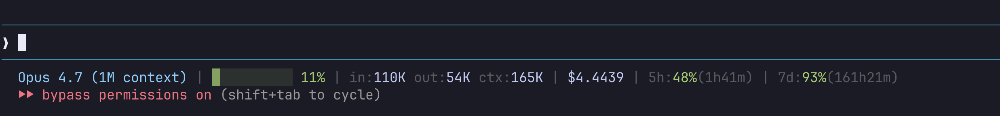

# claude-statusline

# I put the 5h + 7d rate-limit countdown on my Claude Code status line and stopped overshooting the cap

I noticed I was burning through my 5-hour window without knowing where I was in it. The default status line doesn't tell you when the cap resets. I'd push hard thinking "I have more time," then run into the wall mid-task. Same with the 7-day rolling cap.

Once I put the resets on the bar, I started pacing differently.


> My Claude Code status line. Left to right: model (Opus 4.7, 1M context), context bar (11% used), token counters (in:110K out:54K ctx:165K), session cost ($4.4439), 5-hour window (48% remaining, resets in 1h41m), 7-day window (93% remaining, resets in 161h21m). The two countdowns on the right — that's what I plan my day around.

The countdowns are the part that actually changed my behavior — for me. A percentage tells you a state. A countdown tells you when the state ends. `5h:48%(1h41m)` = 48% of the window left, resets in 1h41m. I see that and either close the loop or park the work for after reset.

## Install (one-liner · `jq` required)

Run from inside your project — installs to `./.claude/settings.json` (project-local):

```sh
curl -fsSL https://raw.githubusercontent.com/yemreak/claude-statusline/main/install.sh | sh
```

For a global install (`~/.claude/settings.json`, applies to every Claude Code session) add `-s -- -g`:

```sh
curl -fsSL https://raw.githubusercontent.com/yemreak/claude-statusline/main/install.sh | sh -s -- -g
```

Restart Claude Code · the bar renders on the next turn. The 5h / 7d segments only show on plans where Claude Code populates `rate_limits.five_hour` / `rate_limits.seven_day` (Pro / Max); API-only setups quietly leave those segments empty.

## Uninstall

```sh
# project-local
curl -fsSL https://raw.githubusercontent.com/yemreak/claude-statusline/main/uninstall.sh | sh

# global
curl -fsSL https://raw.githubusercontent.com/yemreak/claude-statusline/main/uninstall.sh | sh -s -- -g
```

## License

MIT · see [LICENSE](LICENSE)
